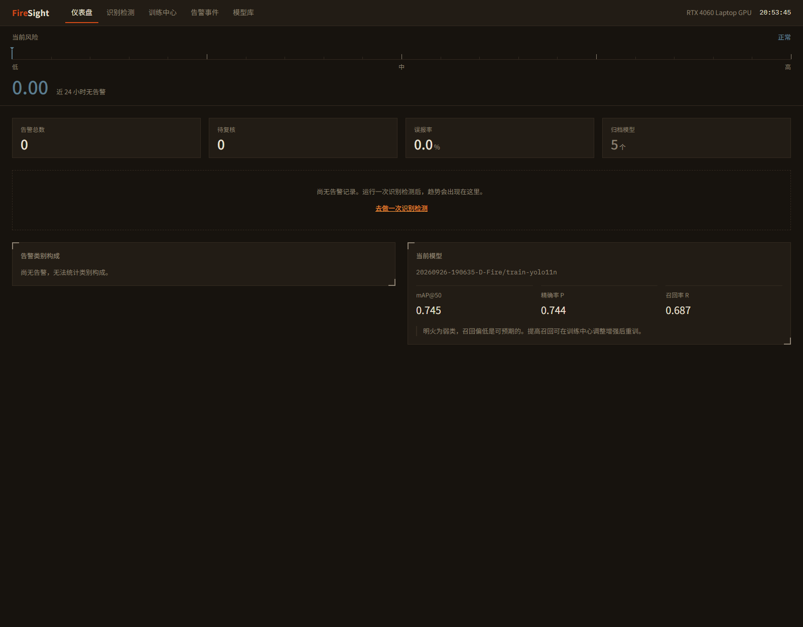

# FireSight · 基于 YOLO 的火灾烟雾智能预警系统

[](CHANGELOG.md)
[](https://www.python.org/)
[](https://vuejs.org/)
[](LICENSE)

在图像与视频中定位并识别**明火**与**烟雾**，输出「类别 + 边界框 + 置信度」，
并把「数据 → 训练 → 推理 → 告警 → 复盘」整条链路收进一个可演示的值班控制台。



> 上图为值班控制台首页：顶部是风险尺（近 24 小时读数），下方依次为告警读数、
> 30 日趋势、类别构成与当前模型。右上角可直接进入月度大屏。

---

## 这是什么

多数火灾检测项目止步于「训出一个模型」。FireSight 想解决的是它后面的工程问题：
数据版本怎么冻结、训练产物怎么归档、实验之间怎么对比、告警误报怎么复核。

因此它是一条**完整链路**，而不只是一个推理脚本：

- **数据侧** —— 多种标注格式统一转换、固定种子冻结划分、五项质检并出具 HTML 报告
- **训练侧** —— 配置三源合并（默认值 / YAML / 命令行）、训练产物自动归档、多权重对照评估
- **推理侧** —— 可插拔帧输入（摄像头 / 视频 / 图片夹 / RTSP）、多帧时序确认抑制误报、告警事件入库与片段留存
- **界面侧** —— Vue 控制台，把上述能力变成可点击、可演示、可复盘的产品

**核心认知：算法是可替换的变量，工程链路是稳定的常量。**

---

## 核心特性

| 能力 | 说明 |
|---|---|
| 多源帧输入 | 摄像头、视频文件、图片目录、RTSP 流，统一为可插拔的帧源 |
| 冻结划分 | 固定随机种子，同一数据集重复划分结果 100% 一致，训练只读该划分 |
| 数据质检 | 图-标配对、坐标越界、类别不平衡、划分泄漏等五项检查 + HTML 报告 |
| 时序确认 | 连续 N 帧检出才触发告警，显著降低夕阳、车灯、蒸汽等场景的误报 |
| 告警闭环 | 中文语音播报 + 事件写入 SQLite + **告警前后各 30 秒**视频片段留存 |
| 实验归档 | 每次训练自动归档权重、配置与指标，可随时还原与横向对比 |
| 常驻监控 | 网页启停一路 RTSP/视频监控：MJPEG 实时画面、断线退避重连、与训练互斥（训练优先） |
| 分析报告 | 大模型按选定区间生成火情分析与防火建议，落盘归档、可回看下载 |
| 月度大屏 | 近 12 个月趋势、24 小时时段分布与环比，独立页面供投影/汇报 |
| 模型管理 | 指定当前权重、多权重对比评估、权重下载、断点续训、删除可恢复 |
| 值班控制台 | 风险尺、告警趋势、事件复核、训练、模型、报告、大屏，集中在一个界面 |

### 类别约定

全链路统一为两个类别，**顺序即 `class_id`**：

| `class_id` | 名称 | 中文 |
|---|---|---|
| `0` | `smoke` | 烟雾 |
| `1` | `fire` | 明火 |

这一顺序是硬约束，唯一真相在 `apps/fire-sight/src/fire_sight/scene/class_map.py`，其余位置一律引用它，不得另行硬编码。

D-Fire 的原始标注恰好就是 `0=smoke / 1=fire`，与本契约一致（已抽查样本图像确认）。
但**不同公开数据集的约定并不统一，接入新数据集时务必自行核对**：
顺序搞反会让「明火」和「烟雾」整体互换，而模型照常训练、指标照常好看，事后极难发现。

---

## 快速开始

### 环境要求

- Python **3.10+**（开发环境为 3.12.13）
- Node.js **18+**（仅构建前端时需要，开发环境为 22.20.0）
- 可选：NVIDIA GPU + CUDA（GPU 训练与推理；CPU 亦可运行，只是慢）

### 安装

```bash
git clone https://github.com/Cheng-LiXin/FireSight.git
cd FireSight

python -m venv .venv
# Windows
.venv\Scripts\Activate.ps1
# macOS / Linux
source .venv/bin/activate

# 安装引擎端与应用端（含 Web 依赖）
pip install -e "./apps/platform[dev]"
pip install -e "./apps/fire-sight[web]"

fs-init                 # 初始化工作目录
```

### 启动控制台

**最省事：双击根目录的 `启动.cmd` / `关闭.cmd`。** 也可以在终端里：

```powershell
pwsh -File scripts\firesight.ps1 start      # 起服务并等它就绪，报 URL 与版本
pwsh -File scripts\firesight.ps1 stop       # 停服务（含整棵进程树，复查端口已释放）
pwsh -File scripts\firesight.ps1 restart    # 重启
pwsh -File scripts\firesight.ps1 status     # 服务 / 当前权重 / 训练 / GPU / 产物新旧
```

`start` 的常用开关：`-Dev`（同时起前端 dev server 5173，热更新）、`-Build`（先重建前端）、
`-Foreground`（前台运行，Ctrl+C 停）。前端产物缺失时会自动构建；源码比 `dist` 新会提醒。

日志写在 `.runtime/logs/serve-<时间戳>.err.log`（uvicorn 的日志走 stderr）。

> **为什么关闭要「杀整棵树」**：`.venv\Scripts\python.exe` 是个**转发器**，真正在监听的
> 是它的子进程。只杀外壳会留下一个占着 8000 端口、却「看起来已经关了」的孤儿——这个
> 项目踩过两次。`stop` 会沿 python 链找到最顶层再 `taskkill /F /T`。
>
> **为什么不直接用 `fs-serve`**：venv 可能是在这个入口加进 `pyproject.toml` 之前装的
> （那种情况下 `.venv\Scripts` 里只有改名前的 `fs-web.exe`，见下方排错一节），所以脚本
> 走等价的 `python -m fire_sight.cli`，不依赖 console script 的名字。

手动等价命令（脚本出问题时的退路）：

```bash
# 1. 构建前端（首次或前端有改动时执行）
cd apps/web && npm install && npm run build && cd ../..

# 2. 启动服务
.\.venv\Scripts\python.exe -m fire_sight.cli --host 127.0.0.1 --port 8000
```

浏览器打开 <http://127.0.0.1:8000> 即可。

前端开发模式（热更新，需另开一个终端跑服务）：

```bash
cd apps/web && npm run dev     # http://localhost:5173，自动代理 /api 到 8000
```

---

## 完整流程：从数据到监测

### 1. 放入原始数据

数据放在 `data/raw/` 下，每个数据集一个目录。两种布局都支持：

**A. 已切分好的 YOLO 数据集**（仓库内 D-Fire 即此布局）

```text
data/raw/D-Fire/
  train/
    images/          # 17,221 张
    labels/          # 同名 .txt，YOLO 格式
  test/
    images/          # 4,306 张
    labels/
```

**B. 未切分的原始标注**

```text
data/raw/<数据集名>/
  images/            # .jpg / .png ...
  annotations/       # VOC xml / COCO json / YOLO txt
```

公开火灾数据集可选 D-Fire、BowFire、FLAME、VisiFire。
**务必补充负样本**（夕阳、车灯、蒸汽、烟囱白汽），否则误报率会高得无法使用。

> **转换前务必确认源数据的类别顺序。** D-Fire 的原始标签恰好是 `0=smoke / 1=fire`，
> 与我们的契约一致；但不少公开数据集是反的。顺序搞反会让「明火」和「烟雾」整体互换，
> 而模型照常训练、指标照常好看——这类错误极难在事后发现。

### 2. 转换 + 冻结划分

```bash
# 路径相对 data/raw/
fs-transform --dataset "D-Fire/train" --format yolo --classes smoke,fire --seed 42
```

产出 `data/processed/D-Fire/train/`：`images/{train,val,test}`、`labels/{train,val,test}`、`data.yaml`。

> `--dataset` 定位 `data/raw/` 下的**原始数据**（`D-Fire/train` 表示原始数据集已自行切分），
> 产物目录名默认与它相同。想让产物换个名字用 `--name`，例如 `--name D-Fire_train` ——
> 这样不必为了改产物路径去动 `--dataset`。命令结束时会打印后续该用的名字。
>
> `--classes` 的顺序即 `class_id`，**必须**是 `smoke,fire`。传其它顺序会被直接拒绝并说明原因，
> 因为错序会让明火与烟雾整体互换（详见上方「类别约定」）。

### 3. 数据体检

```bash
fs-validate --dataset "D-Fire/train"
```

浏览器打开 `data/processed/D-Fire/train/reports/quality_report.html`。

### 4. 训练

```bash
# 生成配置模板（只需一次，之后可直接改 YAML）
fs-gen-config --kind train

# 快速试跑：取 40% 子集 + 缓存，几分钟能看出方向
fs-train --dataset "D-Fire/train" --model yolo11n.pt --epochs 10 --batch 16 --fraction 0.4 --cache --device 0

# 完整训练（推荐默认）
fs-train --dataset "D-Fire/train" --model yolo11n.pt --epochs 50 --batch 16 --imgsz 640 --device 0
```

训练结束后自动归档到 `models/trained/<run_id>/`（`best.pt` + 配置 + 指标）。

### 5. 评估与对照

```bash
fs-val --dataset "D-Fire/train" --weights models/trained/<run_id>/best.pt

# 两个权重横向对照
fs-val --dataset "D-Fire/train" \
  --weights models/trained/<run_a>/best.pt models/trained/<run_b>/best.pt
```

### 6. 推理与告警

```bash
# 图片目录
fs-infer --source data/raw/D-Fire/test/images \
         --weights models/trained/<run_id>/best.pt --max-frames 20 --no-tts

# 摄像头 / 视频 / RTSP 同理，--source 换成对应路径即可
fs-infer --source 0 --weights models/trained/<run_id>/best.pt
```

告警事件写入 `data/events/events.db`，片段存于 `data/events/clips/`。
回到控制台的「告警事件」与「仪表盘」即可查看。

---

## 命令速查

| 命令 | 作用 |
|---|---|
| `fs-init` | 初始化工作目录与环境快照 |
| `fs-transform` | 原始数据集 → 可训练 YOLO 成品（转换 + 冻结划分） |
| `fs-validate` | 数据质检（只读），产出 HTML / JSON 报告 |
| `fs-gen-config` | 反射生成自解释的 YAML 运行配置模板 |
| `fs-train` | 训练：配置合并 → 训练 → 归档 |
| `fs-val` | 模型评估 / 多权重对照 |
| `fs-infer` | 多源推理 + 告警闭环 |
| `fs-serve` | 启动 REST 服务并托管控制台前端 |

完整参数见 [`docs/api/`](docs/api/)。

---

## 项目结构

```text
FireSight/
├── apps/
│   ├── platform/          # 引擎端 fire_sight_platform：数据 / 训练 / 评估 / 推理
│   ├── fire-sight/        # 应用端 fire_sight：场景包 + 数据服务 + REST 层
│   │   └── src/fire_sight/
│   │       ├── scene/         # 类别契约、多帧时序确认、告警策略
│   │       ├── alerting/      # 事件库、片段缓冲、语音播报
│   │       ├── services/      # 数据服务层（路由只调这里）
│   │       └── api/           # FastAPI 路由
│   └── web/               # 前端：Vue 3 + TypeScript + Vite + ECharts
│       └── e2e/           # Playwright 端到端用例（驱动系统 Edge）
├── frame_source/          # 顶层能力包：可插拔帧输入
├── visualization/         # 顶层能力包：检测框绘制、中文标签
├── scripts/               # 一键启动/关闭（firesight.ps1，含整棵进程树）
├── data/                  # raw 只读原始 / processed 冻结划分 / events 事件库 / reports 报告归档
├── models/                # pretrained 输入 / trained 归档产物
├── runs/                  # 每次训练的完整现场
├── docs/                  # 项目文档（含 architecture / tech / api / devlog / superpowers）
├── tests/                 # 跨端测试
├── 启动.cmd · 关闭.cmd     # Windows 一键入口
└── .runtime/              # 运行时缓存与日志（已 gitignore，可随时删）
```

**依赖方向单向无环**：`cli → 业务模块 → common`，`inference → frame_source / visualization`，
`fire_sight → fire_sight_platform`。

---

## 技术栈

| 层 | 选型 |
|---|---|
| 深度学习 | PyTorch、Ultralytics YOLO11 |
| 视觉 | OpenCV |
| 后端 | FastAPI、Uvicorn、Pydantic、SQLite |
| 前端 | Vue 3、TypeScript、Vite、ECharts、marked + DOMPurify |
| 大模型 | `anthropic` SDK（Claude）/ OpenAI 兼容接口（DeepSeek、SiliconFlow、自定义），按环境变量切换 |
| 语音 | pyttsx3（离线中文播报，无设备时降级为日志） |
| 配置 | PyYAML、Pydantic 三源合并 |
| 质量 | pytest、Ruff、Mypy、Playwright |

---

## 实测结果

YOLO11s 在 D-Fire 上训练 100 epochs（采用提供方划分 `data/raw/D-Fire`，
train / val / test = 14,122 / 3,099 / 4,306；`imgsz=640, batch=20, lr0=0.01,
seed=42, patience=10, fraction=1.0`，RTX 4060 Laptop 8GB）：

| 指标 | 数值 |
|---|---|
| mAP@50 | **0.792**（val）/ 0.793（test） |
| mAP@50-95 | 0.471 |
| 精确率 P | 0.789 |
| 召回率 R | 0.733 |

对应归档 `models/trained/20260928-165715-D-Fire-raw-yolo11s`，可在模型库「设为当前」。
混淆矩阵、PR 曲线等训练图件随每次运行归档在 `runs/training/<run>/`（本地文件，不入库）；
泄漏量化的完整分析见
[`docs/devlog/2026-09-28-新数据首训与泄漏的量化.md`](docs/devlog/2026-09-28-新数据首训与泄漏的量化.md)。

召回（0.733）仍低于精确率（0.789）——**漏检是当前的主要短板**。可试的方向：
更大输入尺寸、针对明火的定向数据增强，或按机位分组的划分来测真实泛化能力。

> ⚠️ **这些数字是「同机位」性能，不能直接当作跨场景泛化能力。**
> D-Fire 由固定监控摄像头采集；即便沿用提供方划分，train 与 val 之间仍大概率
> 存在同机位相邻帧的重叠（旧版实测：≤0 汉明距离的相邻帧占 21.1%，间隔 10–13 秒）。
> 模型可以靠记住背景拿到不属于泛化的分数。要评估真实泛化，需按**机位/视频来源**
> 分组划分，或另找一批未见过的场景做终评。

> 旧数据（`data/processed/D-Fire`）训出的归档在模型库里标着**「旧数据不可比」**：
> 新旧划分有 17,221 张交集，在旧 val 上评估会虚高，指标不可与新数据直接比。

---

## 文档

| 文档 | 内容 |
|---|---|
| [`docs/README.md`](docs/README.md) | 文档索引，从这里进入 |
| [`docs/ROADMAP.md`](docs/ROADMAP.md) | 阶段路线图与完成情况 |
| [`docs/tech/`](docs/tech/) | 各阶段技术设计 |
| [`docs/api/`](docs/api/) | CLI 与 REST 接口说明 |
| [`docs/architecture/`](docs/architecture/) | 架构决策记录（ADR） |
| [`docs/devlog/`](docs/devlog/) | 开发日志 |
| [`CHANGELOG.md`](CHANGELOG.md) | 版本变更记录 |

---

## 常见问题

**`fs-train` 报「找不到数据集 yaml」**
先执行 `fs-transform`。`fs-train` 与 `fs-val` 的 `--dataset` 接受**已处理数据集名**
（如 `"D-Fire/train"`，对应 `data/processed/D-Fire/train/data.yaml`），也可以直接给 `data.yaml` 路径。

注意它与 `fs-transform` 的 `--dataset` 方向相反：`fs-transform` 用它定位 `data/raw/` 下的
原始数据，另外两个用它定位 `data/processed/` 下的成品。**`fs-transform` 结束时会把该用的名字打印出来，照抄即可。**

**`fs-transform` 报「类别顺序必须…」**
`--classes` 的顺序即 `class_id`，硬性要求 `smoke,fire`。这不是可以迁就的选项——
错序会让明火与烟雾整体互换。若你的数据集标注顺序不同，请按名字正确转换，而不是调换 `--classes` 去迎合。

**中文标签显示成方框**
系统缺少中文字体。Windows / macOS 一般自带；Linux 可安装 `fonts-noto-cjk`。

**CUDA 不可用 / 装成了 CPU 版 torch**
pip 会把已装的 CPU 版当作已满足依赖。需先卸载再从 CUDA 源重装：

```bash
pip uninstall torch torchvision -y
pip install torch torchvision --index-url https://download.pytorch.org/whl/cu126
```

**显存不足（8GB 显卡）**
训练与推理不可同时进行，控制台内置了全局互斥锁。除此之外，**提交训练时会按
显卡总显存校验 `batch × imgsz`**，超预算直接返回 400 并给出上限——不必等
ultralytics 报 CUDA OOM。启动面板里也会显示当前 `imgsz` 下的批量上限。
实时监控占着显存时，**训练优先**：点「开始训练」会自动停掉监控并在训练日志里
说明原因；反过来训练进行中启动监控会得到 409 提示。

**分析报告提示「未配置模型通道」**
报告是大模型生成的，走哪条通道由环境变量决定，不配就生成不了：

```bash
# 默认 DeepSeek（OpenAI 兼容）
set FIRESIGHT_LLM_API_KEY=sk-xxxx

# 可选：换通道 / 换模型 / 换端点
set FIRESIGHT_LLM_PROVIDER=deepseek   # deepseek | siliconflow | claude | custom
set FIRESIGHT_LLM_MODEL=deepseek-chat
set FIRESIGHT_LLM_BASE_URL=https://api.deepseek.com
```

设好后重启服务。没配 key 时界面会直接给出上面这行提示，而不是静默失败；
`data/reports/` 下的归档与 `data/events/` 同属运行时产物，已 gitignore。

**磁盘占用：训练会不会写满系统盘**
不会。所有缓存、临时文件与过程副产物都收敛在工作区内的运行时目录
（默认 `.runtime/`，可用 `FIRESIGHT_RUNTIME_DIR` 覆盖），包括训练任务配置、
子进程 `TEMP`、matplotlib 字体缓存、ultralytics 的三处全局目录与评估图件。
`.runtime/` 已在 `.gitignore` 中，随手可删。

**改了前端代码但页面没变**
生产模式读的是 `apps/web/dist/`，需重新 `npm run build`；或改用 `npm run dev` 开发模式。

**`fs-serve` 提示「不是内部或外部命令」**
venv 是在这条入口加进 `pyproject.toml` 之前装的（`.venv\Scripts\` 里可能还留着
改名前的 `fs-web.exe`）。重新生成入口即可，源码是 editable 安装、不必重装包：

```powershell
.\.venv\Scripts\python.exe -m pip install -e ".\apps\fire-sight[web]"
```

---

## 参与贡献

欢迎提 Issue 与 PR。提交前请确保：

```bash
pytest tests apps/platform/tests -q      # 后端，预期 278 passed
cd apps/web && npm run typecheck         # 前端类型检查通过
npm run test:e2e                         # 前端端到端（需先起 fs-serve），预期 40 passed / 3 skipped
```

前端 E2E 用 Playwright 驱动系统已装的 Edge，不下载自带浏览器；
其中会真正跑训练的用例默认跳过，**真调大模型生成报告的用例只在设置了
`FIRESIGHT_LLM_API_KEY` 时才跑**（它会花钱），其余见
[`docs/api/测试说明.md`](docs/api/测试说明.md)。

---

## 许可证

本项目基于 [MIT 许可证](LICENSE) 开源。
