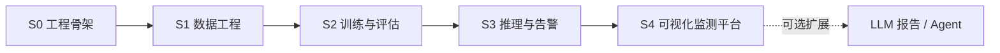

# FireSight 阶段路线图 S0 → S4

> 对齐目标：可**导入数据集**、可**划分训练/测试集**、可**训练**、可**验证**、可**可视化**的火灾烟雾监测平台。  
> 范式来源：ODPlatform 参考实现（`E:\odplatform`）+ 实训方案教学计划。  
> 原则：分阶段开工；新技术栈/新版本先协商；必要处多轮确认。

---

## 一、总览

| 阶段 | 名称 | 一句话目标 | 主要交付 | 状态 |
|---|---|---|---|---|
| **S0** | 工程骨架 | Monorepo 可安装、可跑 CLI 壳 | 双端包 + `fs-init` + 路径/日志基建 | ✅ DONE |
| **S1** | 数据工程 | 导入 → 转换 → 冻结划分 → 质检 | `fs-transform` / `fs-validate` + HTML 体检报告 | 待开工 |
| **S2** | 训练与评估 | 可训练、可复现、可比模型 | `fs-train` / `fs-val` + 实验归档 + 指标报告 | 待开工 |
| **S3** | 推理与告警 | 火情实时检测与告警闭环 | `fs-infer` + 双类场景包 + TTS/片段留存 | 待开工 |
| **S4** | 可视化监测平台 | 业务化监测与复盘界面 | Streamlit 多页 Web + 历史/大屏/复核 | 待开工 |



---

## 一.5、模块划分（已定稿，对齐参考 ODPlatform）

```
FireSight/
├── .firesight-workspace
├── pyproject.toml                 # 仅 ruff/mypy/pytest 共享配置
├── apps/
│   ├── platform/                  # 引擎端 fire_sight_platform
│   │   └── src/fire_sight_platform/
│   │       ├── common/            # paths/logging/lineage/refs/naming/run_context
│   │       ├── data_pipeline/     # convert/ + split/ + orchestrator
│   │       ├── data_validation/   # checks/ + snapshot + service
│   │       ├── runtime_config/    # 三源合并 + 模板生成
│   │       ├── training/          # 训练编排 + 归档 + 指标
│   │       ├── inference/         # 流水线 + OutputSink/InferHooks/CancelToken
│   │       └── cli/               # fs-* 薄入口
│   └── fire-sight/                # 应用端 fire_sight(场景包)
│       └── src/fire_sight/
│           ├── scene/             # 双类/多帧时序确认/告警策略
│           └── web/               # 监测界面(Streamlit)
├── frame_source/                  # 顶层包：摄像头/视频/图片夹/RTSP 可插拔输入
├── visualization/                 # 顶层包：检测框美化、中文标签绘制
├── data/ models/ runs/ docs/ tests/ scripts/
```

**采用的参考模式**

| 模式 | 用在哪 |
|---|---|
| 注册表 + 自动发现 | 转换器、划分策略、质检 check、帧源 |
| snapshot 只读共享 | data_validation 多 check 共用一次扫描 |
| lineage / fingerprint | 冻结划分契约、实验数据身份 |
| inference 三接缝 | 告警 TTS/片段/入库走 InferHooks，不改流水线 |
| 顶层能力包 | frame_source、visualization 与业务解耦 |

依赖方向：`cli → 业务模块 → common`；`inference → frame_source / visualization`；`fire_sight → fire_sight_platform`。单向无环。

---

## 二、阶段明细

### S0 工程骨架（已完成）

| 项 | 内容 |
|---|---|
| 范围 | Monorepo + `apps/` 双端、`.firesight-workspace` 标记、双 pyproject、`common/` 基础层、`fs-init` |
| 结构 | `apps/platform`（`fire_sight_platform`）+ `apps/fire-sight`（`fire_sight`） |
| 验收 | 双端 `pip install -e` 成功；`fs-init` 建目录+环境快照；路径冒烟测试通过 |
| 产出 | 目录树、ADR-001、README、common/cli、空业务模块占位 |

---

### S1 数据工程（对应教学 D3 + 数据侧验收）

**目标**：原始火灾数据集「进得来、转得动、分得稳、查得清」。

| 模块 | 内容 | CLI |
|---|---|---|
| 导入约定 | `data/raw/<数据集名>/{images,annotations}`；D-Fire / BowFire / FLAME / VisiFire + 负样本（夕阳/车灯/蒸汽/烟囱白汽） | `fs-init` 检查 |
| 格式转换 | Pascal VOC XML / COCO JSON / YOLO txt 互转；YOLO 归一化 + 边界 clip | `fs-transform` |
| 冻结划分 | 固定种子（默认 42）train/val/test 一次落盘 `data/processed/`，之后训练只读该划分 | 同上 |
| 质量验证 | 图-标配对、坐标越界/负值/NaN、类别分布与不平衡、易混淆负样本专项分布 | `fs-validate` |
| 质检报告 | Jinja2 + Matplotlib HTML；问题样本移入 `quarantine/`（可恢复） | 同上 |
| 场景常量 | 双类 `flame` / `smoke`（`FireSmokeClass`） | — |

**技术栈**：已有（Python / PyYAML / Pydantic）；计划增加 **Jinja2**（HTML 报告）与 **Matplotlib**（图表）——属参考文档约定依赖，仍属「同范式」，若你要求先确认我再写入 pyproject。

**验收清单**
1. 至少 1 个公开火灾数据集完成 VOC/COCO → YOLO 转换
2. 同一种子重复划分结果 100% 一致
3. `fs-validate` 产出可打开的 HTML 体检报告（含类别柱状图与整改建议）
4. 负样本/易混淆类分布可见，不平衡有预警

**依赖**：S0。

---

### S2 训练与评估（对应教学 D4–D5）

**目标**：配置驱动训练，实验可追溯，指标可对比。

| 模块 | 内容 | CLI |
|---|---|---|
| 运行配置 | DEFAULT → YAML → CLI 三源合并，参数来源可标注，启动前类型校验 | `fs-gen-config` |
| 训练服务 | Ultralytics YOLO11 双类迁移学习；`train.yaml` 全参数；环境快照入库 | `fs-train` |
| 实验归档 | `runs/` 现场 + `models/trained/` 精选；配置+日志+权重三件套；断点续训 `--resume` | 同上 |
| 评估服务 | mAP@50 / mAP@50-95 / P / R、per-class AP、速度三段分析；多 checkpoint 对比表 | `fs-val` |
| 火情指标 | 误报率、召回优先（低置信度召回策略可配） | 同上 |

**技术栈**：torch / ultralytics / pydantic / pyyaml（已在）。版本以当前 venv 实测为准：
- Python 3.12.13
- torch 2.14.0+cpu（**GPU 训练需另确认 CUDA 版组合**）
- ultralytics 8.4.163

**验收清单**
1. 用 S1 冻结数据集跑通 YOLO11n/s 至少一轮完整训练
2. 任意实验可从归档还原配置与权重
3. `fs-val` 输出结构化指标 + per-class AP，能识别弱类（smoke/flame）
4. 对照实验表（至少 2 组）可复现

**依赖**：S1。

---

### S3 推理与告警（对应教学 D5 + 火灾选题系统实现）

**目标**：视频流上稳定出框，并完成告警闭环。

| 模块 | 内容 | CLI |
|---|---|---|
| 推理流水线 | 读帧 → 推理 → 绘制 → 输出；多源输入（摄像头/视频/图片夹/RTSP） | `fs-infer` |
| 场景包 | 双类后处理：低置信度召回 + **多帧时序确认** 抑制假阳 | `fire_sight.scene` |
| TTS 告警 | 中文语音播报火情位置；冷却计时防重复 | `fs-infer` / scene |
| 片段留存 | 告警事件前后约 30s 视频片段落盘，供追溯 | inference sink |
| 事件库 | 告警事件写入 SQLite（时间、类别、位置、置信度、片段路径） | 同上 |

**技术栈**：OpenCV（视频 IO）、可选 imageio/ffmpeg（H.264 写出）、pyttsx3（TTS）。后两项若需引入会先与你确认。

**验收清单**
1. 图片/视频/文件夹三源推理跑通，中文标签不乱码
2. 烟雾/明火样例可检出；夕阳/蒸汽等负样例误报明显下降（时序确认生效）
3. 触发告警后自动生成可播放片段 + 事件入库
4. TTS 播报含位置且有冷却

**依赖**：S2（需可用权重）。

---

### S4 可视化监测平台（对应教学 D6–D7 + 交付主界面）

**目标**：把数据—训练—推理能力收成可演示、可复盘的监测平台。

| 页面 | 功能 |
|---|---|
| 识别页 | 单张 / 批量 / 视频识别，原图-标注对比、KPI、明细表 |
| 历史火情 | 事件筛选、回放片段、误报标注复核 |
| 数据大屏 | 近 30 日趋势、类别分布、误报率/召回概览 |
| 训练面板 | 触发训练/查看实验对比、下载指标 |
| 数据面板 | 导入数据集、触发转换/划分/质检、下载 HTML 报告 |

**技术栈**：Streamlit + SQLite + Plotly（参考教学计划约定）。若超出「同参考」范围会先确认。

**验收清单**
1. 端到端演示：导入 → 划分 → 训练 → 验证 → 视频识别 → 历史查询 → 大屏
2. 全链路无断点，错误有可读提示
3. 交付文档：README 快速开始、配置说明、故障排查表

**依赖**：S1–S3。

---

## 三、阶段外可选扩展（不挡 S0–S4 主交付）

| 扩展 | 说明 | 对应教学 |
|---|---|---|
| LLM 智能报告 | 数据质检/训练诊断/火情分析/防火建议；多模型 OpenAI 兼容 + 三级降级 | D7 产品功能 |
| AI 助手 Agent | 对话式数据准备/训练/诊断；Function Calling + ReAct | D8 |
| 边缘部署 | 模型导出 ONNX / 量化 | 实训目标(4) |
| 多帧增强策略 | 烟雾缓慢漂移场景专项优化 | 火灾选题 |

---

## 四、建议里程碑（按实训 10 天节奏映射）

| 实训日 | 对应阶段 | 里程碑 |
|---|---|---|
| D1–D2 | S0 | 骨架、需求/库表/原型（可在 S4 前补原型稿） |
| D3 | S1 | 数据转换+划分+质检报告 |
| D4–D5 | S2 | 训练归档+评估对比 |
| D5–D6 | S3 | 推理流水线+告警闭环 |
| D6–D7 | S4 | Web 三大识别页+历史+大屏 |
| D8+ | 可选 | Agent / LLM |
| D9–D10 | 收口 | 全链路联调、课程报告、答辩 PPT |

---

## 五、需你拍板的开放点

1. **S1 报告依赖**：允许写入 Jinja2 + Matplotlib 吗？（参考实操文档用到）
2. **S2 GPU**：继续 CPU 训练演示，还是锁定 CUDA 版 torch？若 GPU，请给显卡型号以便定版本组合。
3. **S3 依赖**：OpenCV（必需）+ pyttsx3（TTS）+ ffmpeg/imageio（视频写出）是否批准？
4. **S4 范围**：是否包含「训练面板/数据面板」完整操作，还是只做识别+历史+大屏（训练走 CLI）？
5. **阶段节奏**：确认按 S1 → S2 → S3 → S4 串行推进，还是 S1 后并行推 Web 壳？

---

*文档位置：`docs/ROADMAP.md` | S0 已完成于 2026-09-25*
