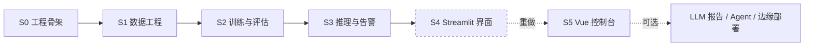

# FireSight 阶段路线图

> 目标：交付一条可**导入数据 → 冻结划分 → 训练 → 验证 → 推理告警 → 可视化复盘**的完整链路。
> 原则：分阶段开工，每阶段有可验证的交付物；新技术栈与新依赖先协商再引入。

---

## 一、总览

| 阶段 | 名称 | 交付 | 状态 |
|---|---|---|---|
| **S0** | 工程骨架 | Monorepo、双端包、工作区路径解析、`fs-init` | ✅ 完成 |
| **S1** | 数据工程 | `fs-transform` / `fs-validate`、冻结划分、HTML 质检报告 | ✅ 完成 |
| **S2** | 训练与评估 | `fs-gen-config` / `fs-train` / `fs-val`、实验归档 | ✅ 完成 |
| **S3** | 推理与告警 | `fs-infer`、帧源、时序确认、事件库、语音播报 | ✅ 完成 |
| **S4** | 可视化监测平台（Streamlit） | 三页 Web 界面 | ⚠️ 已归档 |
| **S5** | 控制台重构（FastAPI + Vue） | REST 服务层 + Vue 值班控制台 | 🚧 进行中 |

**关于 S4 与 S5**：S4 阶段完成的 Streamlit 界面已归档，不再维护。
其后决定采用 FastAPI + Vue 重构界面层——原因是 Streamlit 的交互模型（整页重跑）
无法支撑训练实时曲线、大文件上传等需求。S4 的代码保留在 git 历史中可随时查阅。

---

## 二、已完成阶段

### S0 工程骨架 ✅

Monorepo 布局、`.firesight-workspace` 工作区标记、双端可安装包
（`fire_sight_platform` 引擎端 / `fire_sight` 应用端）、`common/` 基础层、`fs-init`。
决策记录见 [`architecture/ADR-001-monorepo.md`](architecture/ADR-001-monorepo.md)。

### S1 数据工程 ✅

| 模块 | 实现 |
|---|---|
| 格式转换 | Pascal VOC / COCO / YOLO 三种标注统一转为 YOLO，注册表驱动可扩展 |
| 冻结划分 | 固定种子一次落盘 `data/processed/`，训练只读该划分，保证可复现 |
| 数据质检 | 图-标配对、坐标越界、类别不平衡、划分泄漏、划分存在性五项检查 |
| 质检报告 | HTML + JSON 双格式，含类别分布图表 |

设计说明：[`tech/S1-数据工程.md`](tech/S1-数据工程.md) · 命令：[`api/S1-CLI.md`](api/S1-CLI.md)

### S2 训练与评估 ✅

| 模块 | 实现 |
|---|---|
| 运行配置 | 默认值 → YAML → 命令行 三源合并，参数来源可追溯 |
| 训练服务 | Ultralytics YOLO11 迁移学习，配置全参数化 |
| 实验归档 | `runs/` 保留现场，`models/trained/<run_id>/` 归档权重 + 配置 + 指标 |
| 评估服务 | mAP@50 / mAP@50-95 / P / R，支持多权重对照表 |

实测：D-Fire 数据集上 YOLO11n 训练 50 epochs，mAP@50 = 0.745。

设计说明：[`tech/S2-训练与评估.md`](tech/S2-训练与评估.md) · 命令：[`api/S2-CLI.md`](api/S2-CLI.md)

### S3 推理与告警 ✅

| 模块 | 实现 |
|---|---|
| 推理流水线 | 读帧 → 推理 → 绘制 → 输出，多源输入统一抽象 |
| 帧源 | 摄像头 / 视频文件 / 图片目录 / RTSP，注册表驱动 |
| 场景包 | 多帧时序确认抑制假阳，双类独立冷却 |
| 告警副作用 | 中文语音播报、事件写入 SQLite、告警前后片段留存 |

设计说明：[`tech/S3-推理与告警.md`](tech/S3-推理与告警.md) · 命令：[`api/S3-CLI.md`](api/S3-CLI.md)

---

## 三、当前阶段：S5 控制台重构 🚧

**目标**：用 FastAPI + Vue 重建界面层，把引擎能力变成可演示、可复盘的产品。

### 已完成

| 模块 | 内容 |
|---|---|
| 服务层解耦 | 数据服务移出 `web/`，与 HTTP 层分离，供 REST 路由复用 |
| REST 层 | FastAPI 应用，`/api/system/status`、`/api/overview` |
| GPU 互斥 | 全局任务锁，训练与推理串行化，避免 8GB 显存现场溢出 |
| 设计体系 | 热成像取景视觉方向、双色标、三种容器、经校验的图表配色 |
| 仪表盘 | 风险尺、告警读数、按类别堆叠趋势、置信度趋势、类别构成、模型指标 |
| 识别检测 | 单张上传识别（原图与结果对比、检测框账册、参数可调）、目录批量推理 |
| 模型列表 | 归档权重与指标，供识别页选择权重 |

### 待办

| 优先级 | 模块 | 内容 |
|---|---|---|
| P0 | 训练中心 | 历史 run 指标对比、训练曲线、网页启动训练与实时日志流 |
| P1 | 告警事件 | 事件筛选分页、片段回放、标记误报、导出 CSV |
| P1 | 模型库 | 设为当前、下载权重、多权重对比评估 |
| P2 | 工程完善 | ECharts 按需引入（当前单包 1MB）、图表数据表视图、视频文件推理 |

### 技术栈

FastAPI + Uvicorn + Pydantic（后端）· Vue 3 + TypeScript + Vite + Element Plus + ECharts（前端）

设计说明：[`tech/S5-前端架构.md`](tech/S5-前端架构.md) · 接口：[`api/REST-API.md`](api/REST-API.md)

---

## 四、阶段外可选扩展

| 扩展 | 说明 |
|---|---|
| LLM 智能报告 | 数据质检诊断、训练结果分析、火情处置建议 |
| AI 助手 Agent | 对话式数据准备与训练诊断（Function Calling） |
| 边缘部署 | 模型导出 ONNX / 量化，便于嵌入式设备运行 |
| 实时监控页 | 摄像头 / RTSP 常驻监控（需解决与前端的显存争抢） |

---

## 五、版本对应

详见 [`CHANGELOG.md`](../CHANGELOG.md)。

| 版本 | 对应阶段 |
|---|---|
| v1.0.0 | S0–S3 引擎全链路 + S5 仪表盘（首个公开发布） |
| v1.1.0 | 识别检测（单图 / 批量） + 模型列表 |

---

*最后更新：2026-09-26*
