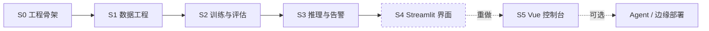

# FireSight 阶段路线图

> 目标：交付一条可**导入数据 → 冻结划分 → 训练 → 验证 → 推理告警 → 可视化复盘**的完整链路。
> 原则：分阶段开工，每阶段有可验证的交付物；新技术栈与新依赖先协商再引入。

---

## 一、总览

| 阶段 | 名称 | 交付 | 状态 |
|---|---|---|---|
| **S0** | 工程骨架 | Monorepo、双端包、工作区路径解析、`fs-init` | ✅ 完成 |
| **S1** | 数据工程 | `fs-transform` / `fs-validate`、冻结划分、HTML 质检报告 | ✅ 完成 |
| **S2** | 训练与评估 | `fs-gen-config` / `fs-train` / `fs-val`、实验归档 | ✅ 完成 |
| **S3** | 推理与告警 | `fs-infer`、帧源、时序确认、事件库、语音播报 | ✅ 完成 |
| **S4** | 可视化监测平台（Streamlit） | 三页 Web 界面 | ⚠️ 已归档 |
| **S5** | 控制台重构（FastAPI + Vue） | REST 服务层 + Vue 值班控制台 | 🚧 进行中 |

**关于 S4 与 S5**：S4 阶段完成的 Streamlit 界面已归档，不再维护。
其后决定采用 FastAPI + Vue 重构界面层——原因是 Streamlit 的交互模型（整页重跑）
无法支撑训练实时曲线、大文件上传等需求。S4 的代码保留在 git 历史中可随时查阅。

---

## 二、已完成阶段

### S0 工程骨架 ✅

Monorepo 布局、`.firesight-workspace` 工作区标记、双端可安装包
（`fire_sight_platform` 引擎端 / `fire_sight` 应用端）、`common/` 基础层、`fs-init`。
决策记录见 [`architecture/ADR-001-monorepo.md`](architecture/ADR-001-monorepo.md)。

### S1 数据工程 ✅

| 模块 | 实现 |
|---|---|
| 格式转换 | Pascal VOC / COCO / YOLO 三种标注统一转为 YOLO，注册表驱动可扩展 |
| 冻结划分 | 固定种子一次落盘 `data/processed/`，训练只读该划分，保证可复现 |
| 数据质检 | 图-标配对、坐标越界、类别不平衡、划分泄漏、划分存在性五项检查 |
| 质检报告 | HTML + JSON 双格式，含类别分布图表 |

设计说明：[`tech/S1-数据工程.md`](tech/S1-数据工程.md) · 命令：[`api/S1-CLI.md`](api/S1-CLI.md)

### S2 训练与评估 ✅

| 模块 | 实现 |
|---|---|
| 运行配置 | 默认值 → YAML → 命令行 三源合并，参数来源可追溯 |
| 训练服务 | Ultralytics YOLO11 迁移学习，配置全参数化 |
| 实验归档 | `runs/` 保留现场，`models/trained/<run_id>/` 归档权重 + 配置 + 指标 |
| 评估服务 | mAP@50 / mAP@50-95 / P / R，支持多权重对照表 |

实测：D-Fire 数据集上 YOLO11n 训练 50 epochs，mAP@50 = 0.745。

设计说明：[`tech/S2-训练与评估.md`](tech/S2-训练与评估.md) · 命令：[`api/S2-CLI.md`](api/S2-CLI.md)

### S3 推理与告警 ✅

| 模块 | 实现 |
|---|---|
| 推理流水线 | 读帧 → 推理 → 绘制 → 输出，多源输入统一抽象 |
| 帧源 | 摄像头 / 视频文件 / 图片目录 / RTSP，注册表驱动 |
| 场景包 | 多帧时序确认抑制假阳，双类独立冷却 |
| 告警副作用 | 中文语音播报、事件写入 SQLite、告警前后片段留存 |

设计说明：[`tech/S3-推理与告警.md`](tech/S3-推理与告警.md) · 命令：[`api/S3-CLI.md`](api/S3-CLI.md)

---

## 三、当前阶段：S5 控制台重构 🚧

**目标**：用 FastAPI + Vue 重建界面层，把引擎能力变成可演示、可复盘的产品。

### 已完成

| 模块 | 内容 |
|---|---|
| 服务层解耦 | 数据服务移出 `web/`，与 HTTP 层分离，供 REST 路由复用 |
| REST 层 | FastAPI 应用，`/api/system/status`、`/api/overview` |
| GPU 互斥 | 全局任务锁，训练与推理串行化，避免 8GB 显存现场溢出 |
| 设计体系 | 现代简约灰白黑：界面无彩、彩色额度只留一个给告警、三种容器、经校验的图表配色 |
| 仪表盘 | 风险尺、告警读数、按类别堆叠趋势、置信度趋势、类别构成、模型指标 |
| 识别检测 | 单张上传识别（原图与结果对比、检测框账册、参数可调）、目录批量推理 |
| 模型列表 | 归档权重与指标，供识别页选择权重 |
| 训练中心·回看 | 训练记录账册、损失与指标曲线、混淆矩阵与 PR 曲线等现场图件 |
| 训练中心·实时 | 网页启动训练（子进程）、SSE 推送逐轮曲线与日志、停止任务 |
| 前端 E2E | Playwright 驱动系统 Edge：覆盖上传、账册对齐、窄屏、启动训练全流程 |
| 运行时收敛 | 缓存 / 临时文件 / ultralytics 全局目录统一改道 `<工作区>/.runtime/`，不再写系统盘 |
| 显存守卫 | 按 GPU 总显存与**模型规模因子**给出 `batch × imgsz` 上限，超预算在起进程之前返回 400；因子由真实训练实测 |
| 告警事件 | 筛选分页、片段回放、标记误报、导出 CSV；筛选在 SQL 层做 |
| 模型库 | 归档列表与指标、**设为当前**（不再等于「最新归档」）、下载权重、多权重对比评估（后台任务 + 轮询） |
| 断点续训 | 从任意训练现场继续（`resume_run_id`）；判据是检查点里还有没有优化器状态——跑完的现场被 `strip_optimizer` 剥掉了 |
| 训练表单参数 | 「模型」改为下拉（六个规模全列、本机没有的标「需下载」、默认取第一个本地已有的），与显存守卫共用同一份清单 |
| 删除归档/现场 | 移进 `models/.trash/` 而非抹掉；可勾选是否连同训练现场一起删 |
| 数据集换代 | 训练统一使用提供方给出的 `data/raw/D-Fire`（就地训练，不建 processed 副本）；旧数据训的归档标「旧数据不可比」 |
| 评估划分 | 对比评估可选 `val`（选模型）或 `test`（最终汇报），默认 val；`train` 不在列表里 |
| 训练几何入列表 | 训练记录显示 `batch` / `imgsz`（取自现场 `args.yaml`），不同几何的结果不可直接比 |
| LLM 智能报告 | 大模型火情分析报告：模型通道适配（DeepSeek / SiliconFlow / Claude）、事件摘要与 Prompt、Markdown 归档、后台生成任务与 REST、报告页（生成 / 展示 / 下载 / 历史回看） |

### 待办

| 优先级 | 模块 | 内容 |
|---|---|---|
| P2 | 工程完善 | ECharts 按需引入（当前单包 1MB）、图表数据表视图、视频文件推理 |

### 技术栈

FastAPI + Uvicorn + Pydantic（后端）· Vue 3 + TypeScript + Vite + Element Plus + ECharts（前端）

设计说明：[`tech/S5-前端架构.md`](tech/S5-前端架构.md) · 接口：[`api/REST-API.md`](api/REST-API.md)

---

## 四、阶段外可选扩展

| 扩展 | 说明 |
|---|---|
| AI 助手 Agent | 对话式数据准备与训练诊断（Function Calling） |
| 边缘部署 | 模型导出 ONNX / 量化，便于嵌入式设备运行 |
| 实时监控页 | 摄像头 / RTSP 常驻监控（需解决与前端的显存争抢） |

---

## 五、版本对应

详见 [`CHANGELOG.md`](../CHANGELOG.md)。

| 版本 | 对应阶段 |
|---|---|
| v1.0.0 | S0–S3 引擎全链路 + S5 仪表盘（首个公开发布） |
| v1.1.0 | 识别检测（单图 / 批量） + 模型列表 |
| v1.2.0 | 训练中心（回看）：曲线与现场图件 |
| v1.3.0 | 训练中心（实时）：网页启动训练与实时曲线 |
| v1.3.1 | 前端 E2E 测试与两处界面修复 |
| v1.3.2 | 运行时目录收敛（不再写系统盘）与训练显存守卫 |
| v1.4.0 | 视觉方向重做：现代简约灰白黑（替换热成像取景）、配色校验器重建 |
| v1.5.0 | 告警事件模块（筛选分页 / 片段回放 / 标记误报 / 导出 CSV） |
| v1.5.1 | 显存守卫补模型规模因子；修 E2E 里一条从没执行过的用例 |
| v1.6.0 | 模型库模块（设为当前 / 下载权重 / 多权重对比评估）；当前权重改为用户指定 |
| v1.7.0 | 断点续训：从任意训练现场继续；跑完的现场不可续（优化器已被剥离） |
| v1.8.0 | 数据集换代（统一用 `data/raw/D-Fire`，旧归档标不可比）；训练表单模型下拉；删除归档/训练现场；评估可选 val/test |
| v1.8.1 | 训练记录显示 batch / imgsz；删除读已消失目录且无人调用的 `StatsService` 死代码 |
| v1.9.0 | 告警片段前后各 30 秒；月度火情统计大屏；RTSP 常驻监控（与训练互斥）；大模型分析报告；「被新归档顶掉」可见化 |

---

*最后更新：2026-09-30*
